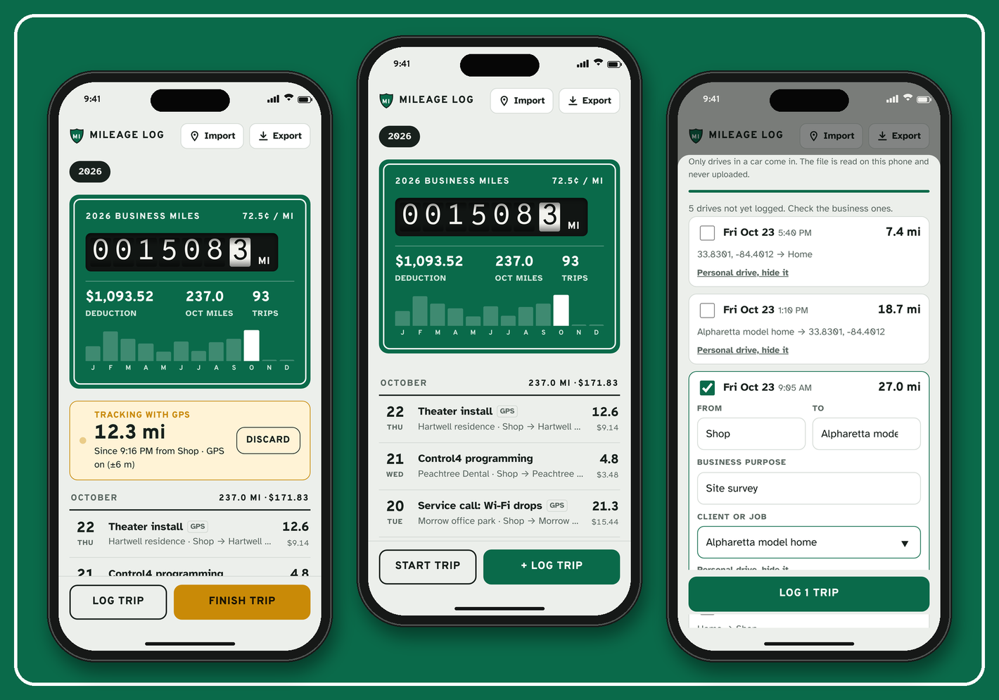
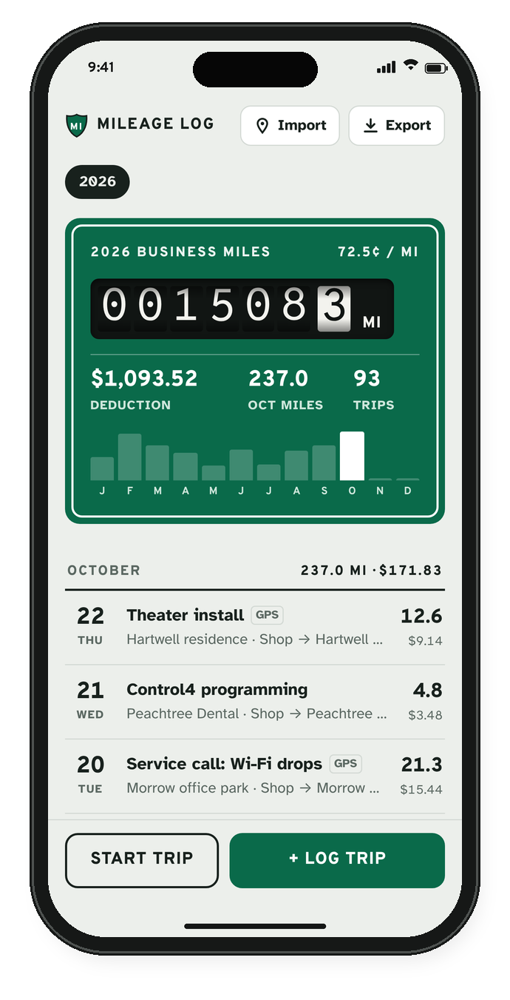
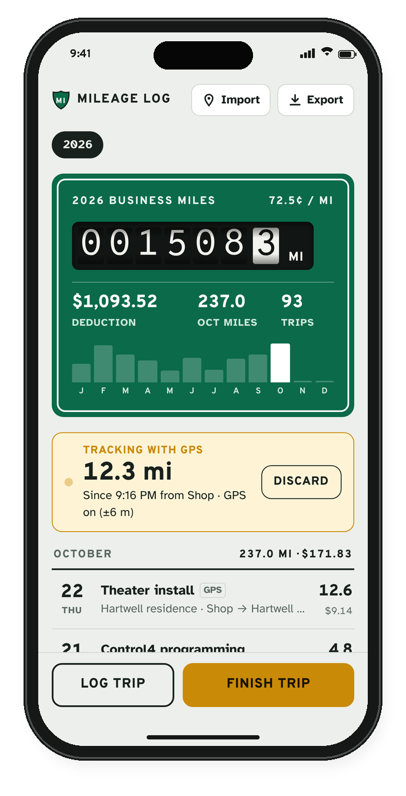
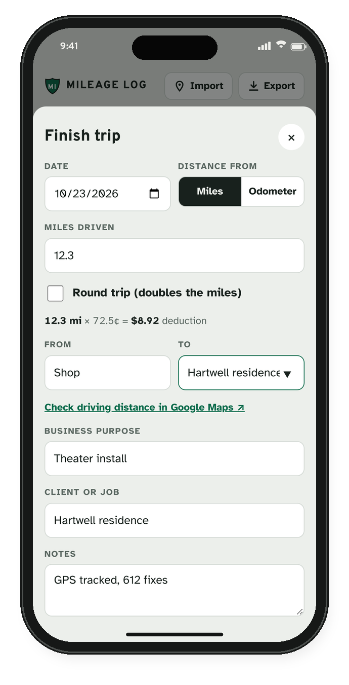
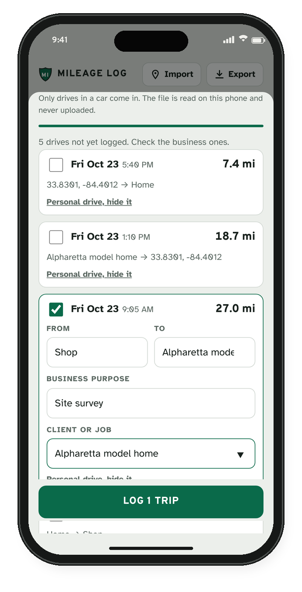
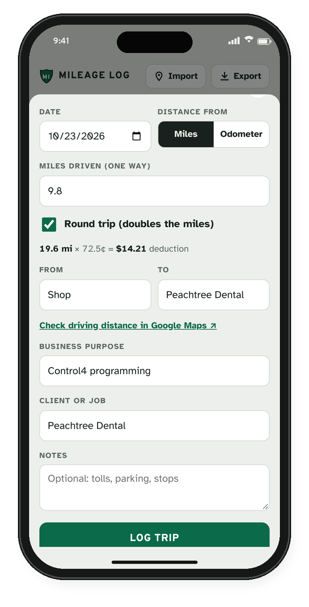
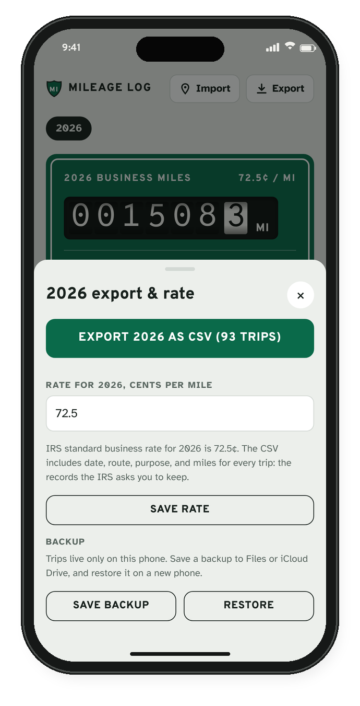
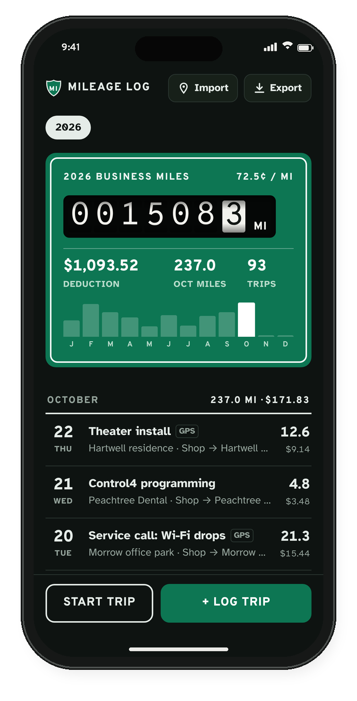

# Mileage Log

A free business mileage tracker for iPhone. Track a drive live with GPS, or pull
past drives in from Google Maps Timeline. It totals your business miles and the
IRS deduction for the year, and exports a CSV your accountant can use.

**Open it:** <https://tjdoolittle.github.io/mileage-log/>

No account, no server, no tracking. Your trips are stored on your phone and
never leave it unless you export them.

## Features

- **Live GPS trips.** Tap Start trip, keep the app on screen in a dash mount,
  and it measures the drive as you go. Tap Finish when you arrive and the miles,
  start point, and end point fill themselves in.
- **Google Maps Timeline import.** Google already records your drives in the
  background. Export your Timeline, import the file, check the business drives,
  and add a purpose. Personal drives can be hidden so they never show up again.
- **It learns your places.** Rename a spot once (a client's house, your shop,
  the supply house) and future GPS trips and imports label it automatically.
- **Manual entry.** Log by miles (with a round-trip toggle) or by odometer
  readings. Once From and To are filled in, a link opens Google Maps directions
  so you can double-check the distance.
- **Tax-ready totals.** A highway-sign odometer shows the year's business miles,
  the deduction, this month's miles, and a month-by-month chart. Tap the year on
  the sign to switch tax years.
- **Rates that change midyear.** Each trip uses the IRS rate in effect on the
  day it was driven. 2026 is built in: 72.5¢ per mile through June 30, then 76¢
  from July 1. Tap the rate on the sign to add a rate change, edit one, or go
  back to the IRS rates.
- **IRS-friendly records.** Every trip requires a business purpose and keeps the
  date, start and end points, and miles, the details the IRS expects in a
  mileage log.
- **CSV export, backup, and restore.** Export any year as a CSV with a totals
  row. Save a full backup to Files or iCloud Drive and restore it on a new phone.
- **Works offline** and installs to the home screen like an app. Light and dark
  mode follow your phone's setting.

## Screenshots

| Year summary | Live GPS trip | Finish a trip |
| --- | --- | --- |
|  |  |  |

| Google Maps import | Log a trip by hand | Export and backup |
| --- | --- | --- |
|  |  |  |

| Dark mode |
| --- |
|  |

The trips, clients, and places in these screenshots are made-up sample data.

## Install it on your iPhone

1. Open <https://tjdoolittle.github.io/mileage-log/> in **Safari**.
2. Tap the **Share** button, then **Add to Home Screen**, then **Add**.
3. Open **Mileage** from your home screen. The first time you start a GPS trip,
   allow location access.

Adding it to the home screen matters for more than convenience. Safari can clear
storage for websites you haven't visited in a while, but apps on the home screen
keep their data.

## Tracking a trip with GPS

1. Tap **Start trip**. Leave **Track miles with GPS** checked, and add the
   purpose and client now or when you finish.
2. Keep Mileage Log open on screen while you drive. The app keeps the screen
   awake for you.
3. When you arrive, tap **Finish trip**. The GPS miles, start point, and end
   point are filled in. Review them and tap **Save trip**.

How the distance is measured: the app adds up the distance between GPS fixes.
It ignores fixes less accurate than about 65 meters, small movements while
you're parked (GPS drift), and impossible jumps.

**One iPhone limitation to know.** iOS pauses location for web apps when the
screen locks or you switch to another app. If that happens mid-trip, the app
counts the straight-line distance across the gap and notes the gap on the trip,
which can slightly undercount a winding route. For hands-off tracking with the
screen off, use the Google Maps import instead.

## Importing drives from Google Maps

Google Maps Timeline records your drives in the background with GPS, so this is
the most complete source. Timeline needs to be turned on in Google Maps.

1. In Google Maps, tap your profile picture, then **Your Timeline**.
2. Tap **⋯**, then **Location & privacy settings**, then **Export Timeline data**.
3. Save the file to Files.
4. In Mileage Log, tap **Import** and choose the file.
5. Check the business drives, add a purpose (and client if you like), and tap
   **Log trips**. Tap **Personal drive, hide it** on the rest.

Import as often as you like. Drives you've already logged or hidden are skipped.
The file is read on your phone and never uploaded. The app understands the
current Timeline export from iPhone and Android as well as older Google Takeout
"Semantic Location History" files (you can select several monthly files at once).

## Exporting for taxes

Tap **Export**, then **Export 2026 as CSV**. The CSV has one row per trip
(date, from, to, business purpose, client, odometer readings, round trip,
miles, rate, deduction, notes, and whether the trip came from GPS, Google Maps,
or manual entry) plus a totals row. It opens in Numbers, Excel, and Google Sheets.

The deduction uses the IRS standard mileage rate. Check the current rate at
[irs.gov](https://www.irs.gov/tax-professionals/standard-mileage-rates) and talk
to a tax professional about your own situation; this app keeps the records but
isn't tax advice.

## Backing up

Trips live only on your phone. Under **Export**, tap **Save backup** to save a
`.json` file to Files or iCloud Drive. On a new phone, tap **Restore** and pick
that file. Restoring adds trips you don't already have, so it's safe to run
more than once.

## Download and host it yourself

Mileage Log is three files and an icon folder with no build step and no
dependencies. To run your own copy:

1. Download this folder: [`mileage-log.zip`](mileage-log.zip).
2. Unzip it and upload the contents to any **HTTPS** host (GitHub Pages,
   Netlify, Cloudflare Pages, or your own server). Browsers only allow GPS on
   HTTPS pages, so opening `index.html` straight from your computer won't track
   location.
3. Open the URL on your iPhone and add it to your home screen.

To preview on a computer: `python3 -m http.server 8000` in this folder, then
open <http://localhost:8000>. Location works on `localhost` too.

## Files

| File | Purpose |
| --- | --- |
| `index.html` | The whole app: markup, styles, and script in one file. |
| `manifest.webmanifest` | Name, colors, and icons for Add to Home Screen. |
| `sw.js` | Service worker that caches the app for offline use. Bump `VERSION` when you ship changes. |
| `icons/` | App icons. |
| `screenshots/` | Images used in this README. |
| `mileage-log.zip` | Download bundle of the app files. |

Fonts are Overpass (based on the Highway Gothic road-sign lettering), Overpass
Mono, and Atkinson Hyperlegible, loaded from Google Fonts. Without a connection
the app falls back to system fonts.

## Privacy

There's no analytics, no account, and no server. Trips, places, and settings are
saved in your browser's storage on your phone. GPS fixes are processed on the
phone and only the trip's total distance and its start and end points are kept.
Google Timeline files are read locally and never uploaded.
